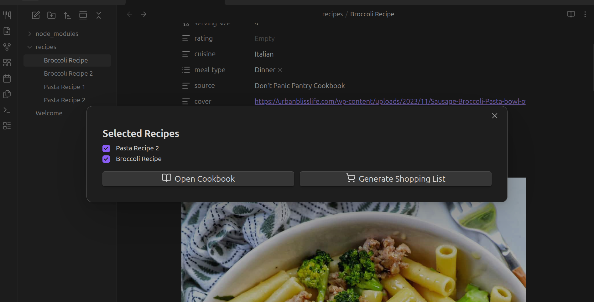
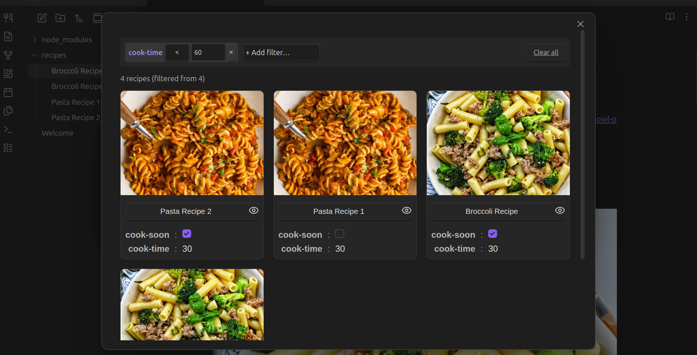
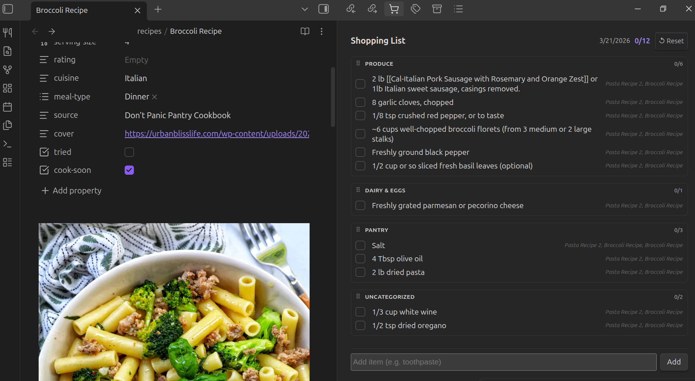

# Cookbook

An [Obsidian](https://obsidian.md) plugin to browse your recipe notes, filter them by frontmatter properties, and generate categorised shopping lists.

## Features

- **Recipe grid** — view all your recipe notes in a card layout with cover images and frontmatter fields
- **Filters** — filter recipes by any frontmatter property; supports string matching and numeric comparisons (`<`, `=`, `>`)
- **Ingredient filters** — filter recipes by ingredient with autocomplete; supports "must contain" and "excludes" with AND/OR logic
- **Dietary group filters** — one-click filters for named ingredient groups (Dairy, Gluten, Nuts, etc.); fully customisable
- **Cook soon** — flag recipes you plan to make this week
- **Serving multiplier** — scale any recipe before generating the shopping list (×2, ×3, etc.) directly from the recipe card, detail view, or ribbon menu
- **Shopping list** — generate a categorised, grouped shopping list from your cook-soon recipes
- **Smart ingredient parsing** — quantities, units, and fractions are extracted automatically; ingredients are aggregated across recipes with unit-aware conversion
- **Custom items** — add one-off items to the shopping list manually; items are auto-categorised by keyword
- **Store aisle maps** — save a route per shop and the list sorts itself into that order; drag categories once and it sticks
- **Drag to reorder** — rearrange shopping list categories by dragging
- **Recipe detail** — click any recipe card to read the full note rendered inside Obsidian
- **Technique tags** — tag prep on ingredient lines (`#prep/dice`, `#prep/mince`); a check command finds typos and untagged prep
- **Ingredient aliases** — tell the cookbook that `green onion` and `scallion` are one ingredient; a names panel suggests likely duplicates to merge
- **Cooks well with** — the recipe detail lists the recipes that share the most distinctive ingredients, and the browser can sort by overlap with your cook-together set
- **Cooking sessions** — mark recipes *cook together* and generate one note with the combined equipment, a prep list grouped by technique, every recipe's steps in a cook order you can arrange by hand, and store/reheat instructions

## How It Works

Cookbook reads notes in your vault and treats any note tagged `#recipe` (configurable) as a recipe. Frontmatter properties are used for display and filtering.

### Example recipe note

Ingredients are read from **checkboxes** (`- [ ]`) anywhere in the note body. Each checkbox line becomes one shopping list item.

```markdown
---
tags: [recipe]
title: Spaghetti Bolognese
cook-time: 45
servings: 4
cover: https://example.com/bolognese.jpg
---

## Ingredients

- [ ] 2 cloves garlic
- [ ] 500g beef mince
- [ ] 1 tin chopped tomatoes
- [ ] 200g spaghetti
- [ ] olive oil

## Steps

Your steps here...
```

Both unchecked `[ ]` and already-checked `[x]` boxes are picked up — the checked state in your note does not affect the shopping list.

#### Quantities and units

The plugin parses quantities and units from the start of each ingredient line. Supported formats:

```text
- [ ] 2 cups flour              →  2 cups flour
- [ ] 1/2 tsp salt              →  1/2 tsp salt
- [ ] 1 1/2 cups milk           →  1 1/2 cups milk
- [ ] 100g butter               →  100 g butter
- [ ] 6 Tbsp. butter            →  6 tbsp butter    (abbreviation period ignored)
- [ ] 2-3 cloves garlic         →  2 cloves garlic  (takes lower of range)
- [ ] 1 1/2 - 2 cups basil      →  1 1/2 cups basil (ranges of fractions too)
- [ ] 4 garlic cloves           →  4 cloves garlic  (trailing count unit)
- [ ] 1 (14-ounce) can milk     →  1 can milk       (size aside ignored)
- [ ] ~6 cups broccoli          →  6 cups broccoli  (strips ~ marker)
- [ ] olive oil                 →  olive oil        (no quantity)
```

Recognised units:

| Kind | Units |
| --- | --- |
| Volume | `tsp`, `tbsp`, `cup/cups`, `pt`, `qt`, `gal`, `ml`, `l`, `fl oz` |
| Weight | `g`, `kg`, `oz`, `lb/lbs` |
| Count | `clove`, `can`, `tin`, `jar`, `stick`, `bunch`, `slice`, `piece`, `package`, `pinch`, `dash`, `head`, `sprig`, `stalk`, `sheet` |

Volume and weight units convert into each other within their kind. Count units never convert — they only add up when the unit is the same, so `2 cloves` and `1 head` of garlic stay as separate lines.

#### Preparation notes

Anything after a `|` is treated as a preparation note rather than part of the ingredient name:

```text
- [ ] 1 large red onion | cut into 1-inch strips
```

A trailing comma clause is also read as preparation when it begins with a preparation word (`chopped`, `divided`, `rinsed`, `to taste`, `optional`, …):

```text
- [ ] 4 garlic cloves, chopped        →  4 cloves garlic     + note "chopped"
- [ ] 7-8 Tbsp soy sauce, to taste    →  7 tbsp soy sauce    + note "to taste"
```

Commas that are simply part of the name are left alone — `1 1/2 lbs boneless, skinless chicken breasts` keeps its full name.

Alternatives belong in parentheses: everything from ` or ` onward is dropped when matching, so write `chicken broth (or vegetable broth)` rather than `chicken or vegetable broth`, which would match as chicken.

#### Technique tags

Tag the prep a line needs with `#prep/<technique>`. Tags can go anywhere on the line; they are lifted off before parsing and shown as part of the prep note.

```text
- [ ] 2 cups butternut squash | #prep/peel #prep/dice small   →  butternut squash  + note "peel, dice · small"
- [ ] 1 medium shallot | #prep/mince                          →  medium shallot    + note "mince"
```

Techniques are a fixed list in settings (peel, halve, seed, quarter, dice, chop, mince, slice, shred, grate, zest, juice, rinse by default), in the order prep is done. Each one also lists the words that mean it, so an untagged `4 garlic cloves, minced` still counts as mince. Run **Check recipe technique tags** to find unknown tags (usually typos) and untagged prep; untagged lines can be fixed with one click.

Because they are ordinary Obsidian tags, selecting `#prep/dice` searches every recipe that dices something, and the browser offers a `technique` filter.

#### Ingredient aliases

Settings → **Ingredient aliases** maps other names onto one canonical name (`scallion` ← `green onion`, `spring onion`). Aliased lines merge on the shopping list, count as overlap and match ingredient filters by any of their names. Matching is exact (after normalisation and ignoring plurals), so an alias never swallows a longer name like `green onion dip`.

**Scan ingredient names** lists every ingredient in your library with how many recipes use it and suggests likely duplicates — `apple` / `red apple`, `ceasar` / `caesar`. **Merge into…** adds the name as an alias.

#### Cooks well with

Two recipes overlap on the distinctive ingredients they share. Staples (salt, oil, dried herbs…) and the Pantry and Baking & Spices aisles are ignored, since they say nothing about shopping or prepping together; both lists are editable in settings. The recipe detail shows the top three matches with the shared ingredients, and **Sort → Overlap with cook-together set** in the browser puts the recipes that best extend your current session first.

#### Cooking sessions

Tick **cook together** on recipes you want to batch-cook (frontmatter `cook-together: true`; separate from cook-soon). **Start cooking session** in the ribbon menu, or the command, writes `Cook session YYYY-MM-DD.md` in the session folder:

- **Recipes** — a colored dot per recipe, with timings and how long each keeps
- **Equipment** — the combined `equipment` lists
- **Prep list** — one section per technique in prep order, each ingredient merged across recipes, with each recipe's dot and amount, so all the peeling happens before all the dicing
- **Cook order** — numbered steps, with *meanwhile* steps under the step they run alongside
- **Store and reheat** — from each recipe's `## Store it` and `## Reheat it` sections
- **My notes** — yours; kept when the session is regenerated

**Arranging the cook order.** Each `---` block of a recipe is one step. Starting a session opens the arrange window: drag steps (or use the arrows) into the order you'll cook them, and tick **Meanwhile** on a step to do it while the step above runs, e.g. soak the cashews while the oats bake. **Save cook order** rewrites the note. The order is stored in the note's `cook-plan` frontmatter, so regenerating keeps it; steps from new or edited recipes are added at the end. Reopen the window from the *Arrange the cook order* link at the top of the note, or the **Arrange cook order** command. Before arranging, recipes run one after another: lowest `oven-temp` first, longest `cook-time` first, stovetop last. A step moved ahead of an earlier step of its own recipe is flagged, not blocked.

The ribbon option *Also mark them cook soon* sends the same recipes to the shopping list. Optional recipe properties used here: `oven-temp`, `equipment`, `fridge-days`, `freezer-months`, `prep-time`, `cook-time`, `serving-size`.

#### Serving multiplier

Each cook-soon recipe has a `− ×1 +` stepper available on the recipe card, in the detail view, and in the ribbon menu. Setting a recipe to ×2 doubles all its quantities in the generated shopping list.

#### Aggregation across recipes

When you generate a shopping list from multiple cook-soon recipes, identical ingredients (matched case-insensitively) are **merged into a single line**:

- **Same unit** — quantities are summed directly (`1 cup flour` + `2 cups flour` = `3 cups flour`)
- **Different units, same type** — converted to a common base and summed (`1 cup milk` + `4 tbsp milk` ≈ `1 1/4 cups milk`)
- **Incompatible units** (e.g. cups vs grams) — kept as separate entries
- **No unit** — aggregated by name only
- The source recipe titles are **combined** and shown as a label under the item so you know where it came from

Names are compared after stripping wikilinks, parentheticals and leading descriptors, so `shredded cheddar cheese` and `cheddar cheese` become one line. The wording of whichever line came first is what you see.

#### Categorising items

Each ingredient goes to the category with the **most specific matching keyword**, not simply the first category that matches. Keywords match whole words only.

That combination is what keeps `full-fat coconut milk` in **Pantry** (the 12-character `coconut milk` beats Dairy's `milk`) and `horseradish cheddar cheese` in **Dairy & Eggs** (Produce's `radish` no longer matches inside `horseradish`).

Items that cannot be matched to a category fall into **Uncategorized** at the bottom of the list.

### Filtering recipes

The recipe browser supports multiple filter types that can be combined:

**Frontmatter filters** — filter by any property on your recipe notes. String properties use exact match; numeric properties support `<`, `=`, `>`.

**Ingredient filters** — search for recipes that must contain (or exclude) a specific ingredient. Type to get autocomplete suggestions drawn from your actual recipe notes. Multiple ingredients can be added to a single filter, with an AND/OR toggle to control how they combine.

**Dietary group filters** — pre-built groups let you filter by broad ingredient categories with a single click:

| Group | Examples |
| --- | --- |
| Dairy | milk, butter, cream, cheese, yogurt… |
| Meat & Poultry | chicken, beef, pork, bacon, lamb… |
| Fish | salmon, tuna, cod, anchovy, haddock… |
| Shellfish | shrimp, prawn, crab, mussel, scallop… |
| Eggs | egg, egg white, mayonnaise, meringue |
| Tree Nuts | almond, walnut, cashew, pistachio… |
| Peanuts | peanut, peanut butter, satay… |
| Soy | soy sauce, tofu, tempeh, edamame, miso… |
| Sesame | sesame, tahini, sesame oil, halva… |
| Gluten | flour, wheat, bread, pasta, barley… |

Fish and shellfish are separate groups, as are tree nuts and peanuts — they are distinct allergens, and someone reacting to shrimp can still eat salmon.

#### Exclusions

Each group also has an **exclusion list** for terms that look like a match but are not one. Without it, a bare `milk` keyword would drag `coconut milk`, `oat milk` and `almond milk` into Dairy, and `noodle` would put `rice noodles` in Gluten.

```
Dairy   keywords   milk, butter, cream, cheese…
        excludes   coconut milk, almond milk, peanut butter, cream of tartar…
```

Exclusions are checked per ingredient line, so a recipe listing both `peanut butter` and `6 tbsp butter` still counts as Dairy — via the second line.

Groups are fully editable in settings — rename them, add keywords, or create your own. You can also use frontmatter flags on individual recipes (e.g. `isVegan: true`) and filter on those directly using the frontmatter filter.

### Using the plugin

1. Click the **utensils icon** in the ribbon to open the quick-access menu
2. Select **Browse recipes** to browse and filter your recipes
3. Mark recipes as **Cook soon** using the checkbox on each card or in the detail view
4. Optionally adjust the **serving multiplier** (`− ×1 +`) on any cook-soon recipe to scale its quantities
5. Back in the ribbon menu, click **Generate Shopping List** to build a shopping list from your cook-soon recipes
6. The **Shopping List** panel opens in the right sidebar — check off items as you shop

**Ribbon menu** — shows your cook-soon recipes and quick actions:



**Recipe browser** — filter and browse your recipes in a card grid:



**Shopping list** — categorised ingredients from your cook-soon recipes:



## Commands

| Command | Description |
| --- | --- |
| **Browse recipes** | Opens the recipe browser |
| **Open shopping list** | Opens the shopping list sidebar panel |
| **Start cooking session** | Writes today's session note for the cook-together recipes and opens the arrange window |
| **Arrange cook order** | Rearranges the steps of the open session note |
| **Check recipe technique tags** | Lists unknown technique tags and untagged prep |

## Settings

### Properties to display

A comma-separated list of frontmatter properties to show on each recipe card (e.g. `title, cook-time, servings, cover`).

### Recipes folder

Restrict recipe scanning to a specific folder. Defaults to the entire vault.

### Recipes tag

The tag that identifies a note as a recipe. Defaults to `#recipe`.

### Cook-soon property

The frontmatter key used to mark a recipe as cook-soon. Defaults to `cook-soon`. Change this if your vault already uses a different key.

### Cover image property

The frontmatter key holding each recipe's cover image. Defaults to `cover`. The value can be a URL, a vault-relative path, a wikilink (`[[cover.png]]`) or a markdown image — all of them resolve to the right picture on the recipe card and in the detail view.

### Ignore paths

A list of folders or files to exclude from recipe scanning. Useful for template folders or example notes.

### Hide checked items

When enabled, checking off a shopping list item removes it from the list immediately instead of showing a strikethrough. Useful for a cleaner shopping experience.

### Preferred volume unit / preferred weight unit

Choose which unit to use when displaying aggregated volume or weight quantities on the shopping list (e.g. prefer `cups` over `ml`). Defaults to auto, which uses whichever unit appears first.

### Ingredient groups

Named groups of ingredient keywords used by the dietary group filters in the recipe browser. Six groups are pre-configured (Dairy, Meat & Poultry, Fish & Seafood, Eggs, Nuts, Gluten). You can add your own groups, edit the keywords, or remove groups you don't need. **Restore defaults** puts the shipped groups back, which is also how you pick up keyword improvements from a plugin update.

### Shopping list categories

Keyword-based categories that group items on the shopping list. When a list is generated, each ingredient is matched against your category keywords and grouped accordingly. Unmatched items go to **Uncategorized**.

Default categories, in default walking order: Produce, Bakery, Deli, Meat & Fish, Dairy & Eggs, Pantry, Baking & Spices, Condiments & Sauces, Drinks, Frozen, Household & Other. **Household & Other** catches non-food items you add by hand, such as toothpaste.

You can add, remove, reorder, and edit categories and their keywords from the settings tab, and **Restore defaults** puts the shipped set back.

Keywords match whole words, so `pea` will not match `peanut butter`. Compound names need their own keyword — the defaults list `blueberries` separately from `berries` for exactly this reason.

The order you arrange categories into on the shopping list is stored against a **store layout** — see below.

### Store layouts

A store layout is a **route**: the order one shop's aisles are walked in. Categories say *what* an ingredient is; a layout says *where it is in this particular shop*.

Reorder categories in the shopping list — by dragging, or with the ▲/▼ buttons — and the new order is saved into the active layout. Learn the route once and every future list comes out in that order.

With more than one layout defined, a picker appears in the shopping list header. Switching re-sorts the current list into that shop's route. Add, rename, duplicate and delete layouts in settings; **Duplicate** is the quick way to start a new shop from a route you already walk.

Layouts reference categories by name, so a category a layout does not mention simply falls to the bottom of the list.

### Cooking sessions

The cook-together property (default `cook-together`) and the folder session notes are written to (default `recipes/cook sessions`).

### Prep techniques

The technique tag prefix (default `prep`) and the ordered technique list. Order is prep order; keywords are the untagged words that count as the technique.

### Ingredient aliases

Canonical names and the other names they absorb, plus the ingredient names panel.

### Overlap

Staple ingredients and ignored aisles, both left out of overlap scoring.

## Installation

### Community plugins (recommended)

1. Open Obsidian Settings → Community plugins
2. Search for **Cookbook**
3. Click Install, then Enable

### Manual

1. Download `main.js`, `styles.css`, and `manifest.json` from the [latest release](../../releases/latest)
2. Copy them to `<your vault>/.obsidian/plugins/cookbook/`
3. Enable the plugin in Obsidian Settings → Community plugins

## Support

Always wondered if I could make a dollar from a project. If you find this plugin useful, you can support development here:

[](https://buymeacoffee.com/digon)
